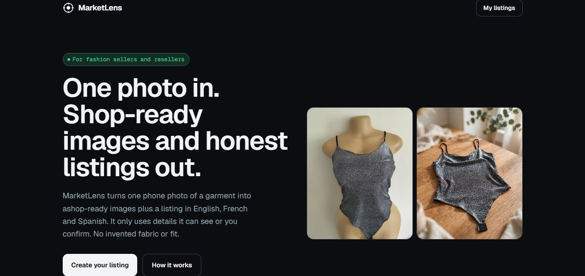
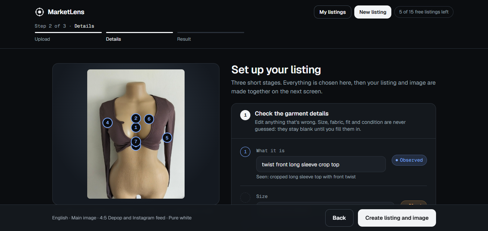
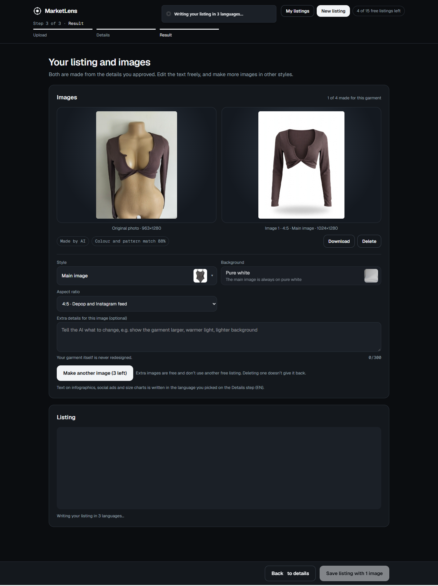
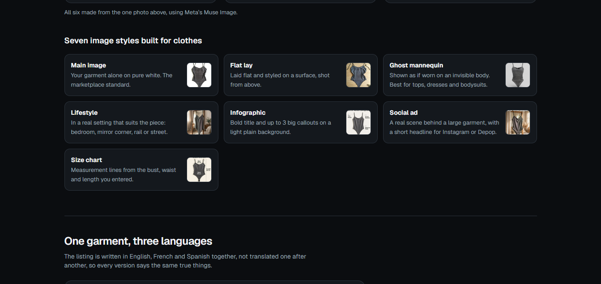

# MarketLens

**One phone photo of a garment in. Honest multilingual listing copy and scroll-stopping listing images out.**

MarketLens is built for people who sell clothes from their phone: resellers, small fashion brands and thrifters posting on Vinted, Depop, Facebook Marketplace, Instagram, WhatsApp or their own store. It turns one photo into a listing in English, French and Spanish, plus a set of fashion-style images, using only details it can see or that you confirm.

Built for the **Meta Global AI Developer Hackathon**. Track: **Build for Your World** (Indie Developer).

- **Live demo:** [marketlens-meta.vercel.app](https://marketlens-meta.vercel.app)
<!-- - **Demo video (3 min):** [Watch on YouTube](https://youtu.be/YOUR_VIDEO_ID) -->



## What existed before, and what I built this week

Before the hackathon, MarketLens did not exist. The repository was created on Oct 26, 2026, and everything in it was built during the event (Oct 26 to Nov 4, 2026).

## Why it exists

Reselling clothes means hours of styling, photographing, measuring and writing, and generic AI tools make it worse by inventing fabric, fit and size. MarketLens does the opposite:

- It lists only what it can **see** (colour, neckline, print) and asks you for what it can't (size, fabric, condition).
- It makes the images **from your own photo**, so your garment's colour, print and fabric are kept.
- It shows any text it will put on an image **for you to check first**, so there are no typos.

## Quick start for judges

You need **Node.js 20 or newer** (or Bun) and a **Meta Model API key**.

1. Get a key at [dev.meta.ai](https://dev.meta.ai) (create a key on the API keys page; credits show on the Billing page).
2. Clone the repo and install:

   ```bash
   git clone https://github.com/Boboinna/marketlens.git
   cd marketlens
   bun install          # or: npm install
   ```

3. Create your environment file and add your key:

   ```bash
   cp .env.example .env.local
   ```

   Open `.env.local` and set:

   ```
   MODEL_API_KEY=your_meta_model_api_key
   QUOTA_SECRET=any_long_random_string
   QUOTA_DISABLED=1
   ```

   `QUOTA_DISABLED=1` turns off the free-listing limit so you can test freely. **Never commit `.env.local` or any real key.** It is already in `.gitignore`.

4. Run it:

   ```bash
   bun run dev          # or: npm run dev
   ```

   Open http://localhost:3000, add a photo of a garment, and follow the steps.

| Variable | Required | What it does |
|---|---|---|
| `MODEL_API_KEY` | Yes | Your Meta Model API key. Server-side only, never sent to the browser. |
| `QUOTA_SECRET` | In production | Signs the free-tier cookie. |
| `QUOTA_DISABLED` | No | Set to `1` to skip the free limit while testing. |
| `MODEL_API_BASE_URL` | No | Override the Meta Model API address. |

## How it works

1. **Upload.** Add 1 to 3 photos of one garment. Only the first is required. A non-clothing photo gets a friendly note that the app is made for clothing, then it still tries.
2. **Details.** Muse Spark reads the photo. Each detail is marked **Observed**, **Confirmed** or **Blank**. You fill in size, fabric, fit, neckline, length, colour, condition, brand and optional measurements (bust, waist, length in cm or in). Then you choose image style, background and aspect ratio.
3. **Text check.** If the style has words on it (Infographic, Social ad, Size chart), you see the exact text, Muse Spark fixes typos, and you can edit it before anything is made.
4. **Result.** Images and the listing appear. Switch between English, French and Spanish, copy the full listing or a ready-to-post Marketplace, Instagram or WhatsApp version, download images, and save to **My listings**.





## Meta models used, and where

Every model the app calls at runtime is a Meta model, called through the Meta Model API. Model names live in one file: `config/models.ts`.

| Model | Route | What it does |
|---|---|---|
| **Muse Spark** (`muse-spark-1.3`) | `/api/analyze` | Reads the photo and lists only what is visible. |
| **Muse Spark** | `/api/listing` | Writes the English, French and Spanish listing, then checks it against your facts and removes unsupported claims. |
| **Muse Spark** | `/api/textcheck` | Proofreads the words that will be printed on an image. |
| **Muse Image** (`muse-image-1.0`) | `/api/visual` | Makes every image. Your original photo is sent as it is. The prompt tells it to remove the mannequin, hands and hanger, keep colour, print and fabric exactly, and complete any gaps. |
| **SAM 3.1** (`sam-3.1`) | `/api/check` | Optional quiet check. Segments the garment in the original and the result and compares colour and pattern. It never blocks anything and is skipped silently if it can't run. |

The `openai` package in `package.json` is only an HTTP client that talks to the Meta Model API.

## Image styles

| Style | What you get |
|---|---|
| Main image | Garment alone on pure white. Marketplace-ready. |
| Flat lay | Garment laid flat, styled on a surface. |
| Ghost mannequin | Garment shown as if worn, no visible body. |
| Lifestyle | Garment in a real setting (bedroom, mirror, street) matched to the piece. |
| Infographic | Bold title, up to 3 large callouts, light plain background. |
| Social ad | A real scene behind a large garment, short headline. |
| Size chart | Only offered when you have entered real measurements. |



**Backgrounds.** Auto (matches the garment) is the default. Or pick from Clean (white, light grey, cream, soft blush), Surfaces (light oak, white marble, linen, bed linen), Rooms (bright bedroom, mirror corner, clothes rail, sunlit room, street) and Bold for ads (terracotta, deep green, lilac, black), or describe your own in about 120 characters. Only backgrounds that suit the chosen style are shown.

## Free listings

The free tier gives a small number of listings per browser (set by `FREE_GENERATIONS` in `config/limits.ts`).

- A listing uses **one** when its first image starts being made.
- Extra images for the same listing (up to 4 in total) are **free** and never use another listing.
- Reading a photo costs nothing, and leaving before an image is made costs nothing.
- If the first image can't be made, the listing is given back.

## Privacy

Photos are sent to Meta's models for processing. Finished listings are saved only in your browser on your device, under **My listings**.

<!-- ## Future ideas

- **Next:** on-model images, bulk listing, CSV export for marketplaces, more languages (Swahili, Portuguese, Arabic) and saved brand presets.
- **Later:** a Shopify app or plugin that creates a product straight from a photo, WooCommerce and other store plugins, WhatsApp Business catalog publishing, accounts with cloud sync, and short videos.
- **Always:** keep the truth-lock, so nothing is written or drawn unless it was seen or confirmed. -->

## Tech

Next.js 15, React 19, Tailwind 4, Zustand, zod, sharp, idb-keyval, browser-image-compression, react-dropzone, sonner. Font: Geist (OFL).

## License

See [LICENSE](https://github.com/Boboinna/marketlens/blob/main/LICENSE).

---

Built for the Meta Global AI Developer Hackathon.
[GitHub](https://github.com/Boboinna) · [Live demo](https://marketlens-meta.vercel.app)